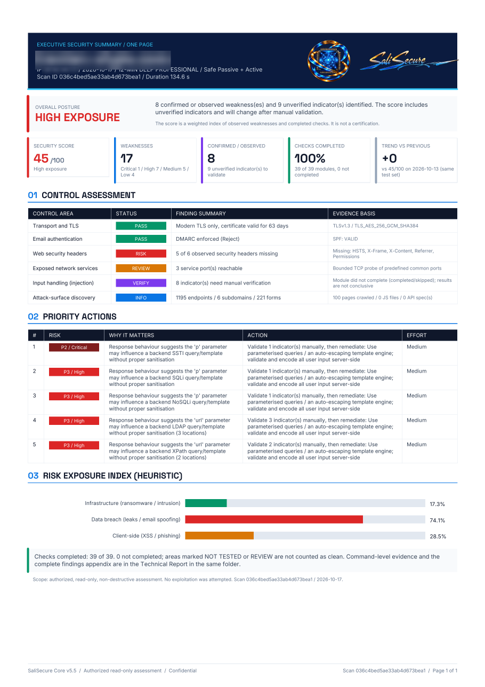
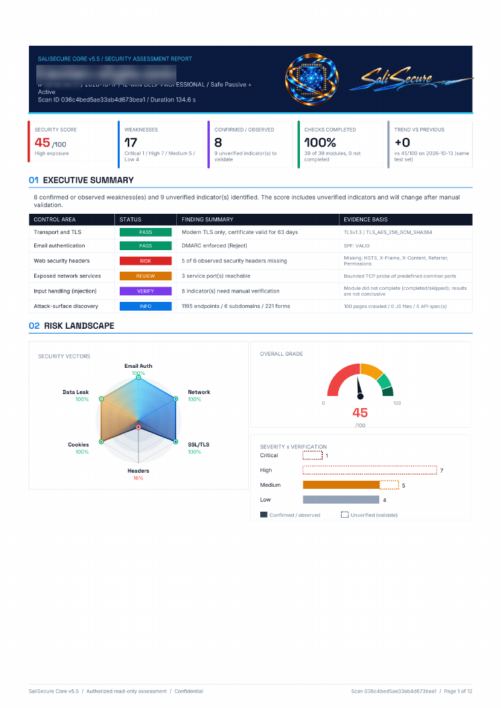

# SaliSecure

**Website security assessment with passive and active checks, and clean PDF reports.**

[Website](https://salisec.ir) · [Documentation](docs/README.md) · [Sample reports](#sample-reports) · [فارسی](README.fa.md)

---

> **This repository contains documentation only.**
> The SaliSecure assessment engine is proprietary software and its source code is **not** published here. Nothing in this repository is needed to use the service; it exists so you can see what SaliSecure checks, how findings are scored, and what the reports look like.

## What is SaliSecure?

SaliSecure is a website security assessment tool. Point it at a domain you are authorized to test, and it runs a bounded set of **39 checks** (20 passive, 19 active), then produces:

- a **multi-page technical report** (PDF) with findings, evidence, CVSS 3.1 vectors, standards mappings and remediation steps;
- a **one-page executive summary** (PDF) for managers and decision makers;
- optional **machine-readable JSON** output for pipelines and dashboards.

A free **trial report** is available on [salisec.ir](https://salisec.ir). It shows the total number of findings, fully explains one or two weaknesses together with their fix, and keeps the remaining details locked. The full report is the paid product.

## Highlights

| | |
|---|---|
| **Dual depth** | Passive-only scans (no probing beyond normal browsing, DNS and certificate-transparency lookups) or passive + active scans with bounded, detection-only probes. |
| **Bounded by design** | Every scan has a hard time limit and hard budgets for requests, DNS queries and response bytes. A scan can never run away. |
| **Honest coverage** | Skipped, failed and timed-out checks are listed in the report. "Not found" is never confused with "not tested". |
| **Transparent scoring** | CVSS 3.1 base scores are computed from the vector printed next to each finding, so you can re-check any score with the FIRST calculator. |
| **Evidence-aware priority** | A separate P0–P4 urgency ranks verified facts above unconfirmed indicators of equal CVSS. |
| **No exploitation** | Detection only. No brute force, credential stuffing, destructive payloads, file upload or exploit execution. |
| **Standards tags** | Findings carry CWE and OWASP Top 10 (2021) tags, plus best-effort WSTG and ASVS references. |

## Scan types

| Scan | Name | Depth | Time limit | Output |
|---|---|---|---|---|
| 1 | General | Passive only | 2 min | Full technical report |
| 2 | Standard | Passive + active | 6 min | Preview reports (demo / free trial) |
| 3 | Deep | Passive + active, larger budgets | 12 min | Full technical report + executive one-page |

Details: [docs/scan-profiles.md](docs/scan-profiles.md)

## What gets checked

Transport and certificates (TLS versions, cipher posture, certificate validity, key size, issuer) · HTTP security headers, cookies, CSP, CORS · DNS, SPF, DKIM, DMARC, CAA, DNSSEC, wildcard DNS, zone-transfer exposure · technology fingerprinting and offline CPE/CVE review notes · robots.txt, sitemap, `/.well-known`, crossdomain policy · certificate-transparency subdomain discovery · exposed common TCP ports · same-origin crawl, forms, JavaScript endpoint intelligence · REST, GraphQL and OpenAPI discovery · HTTP methods, error pages, misconfiguration · open redirect and Host-header indicators · injection indicators (SQLi / NoSQLi / SSTI / LDAP / XPath) · SSRF candidate parameters · login, CSRF, session and MFA posture.

Full list with passive/active classification: [docs/modules.md](docs/modules.md)

## Sample reports

Both samples show the real report layout. The target's identity is redacted.

| Executive summary (1 page) | Technical report (12 pages) |
|---|---|
|  |  |
| [Download PDF](assets/samples/SaliSecure-Sample-Executive-Summary.pdf) | [Download PDF](assets/samples/SaliSecure-Sample-Technical-Report.pdf) |

What each report contains: [docs/reports.md](docs/reports.md)

## Authorization

Only scan systems you own or have **written permission** to test. Active checks send more than ordinary browsing traffic, and testing a system without authorization may be illegal where you live. Read [docs/safety-and-authorization.md](docs/safety-and-authorization.md) before your first scan.

## Documentation

| Document | Contents |
|---|---|
| [Overview](docs/overview.md) | How an assessment runs, end to end |
| [Scan profiles](docs/scan-profiles.md) | 2 / 6 / 12 minute scans and their budgets |
| [Modules](docs/modules.md) | All 39 checks, passive vs active |
| [Methodology](docs/methodology.md) | CVSS, P0–P4 priority, the 0–100 score, confidence levels |
| [Reports](docs/reports.md) | Structure of the technical report and executive summary |
| [Free trial](docs/free-trial.md) | What the free report shows and what stays locked |
| [JSON output](docs/json-output.md) | Machine-readable result format |
| [Safety and authorization](docs/safety-and-authorization.md) | The safety boundary and your responsibilities |
| [FAQ](docs/faq.md) | Common questions |
| [Roadmap](docs/roadmap.md) | Direction (not a commitment) |

Persian documentation: [docs/fa/](docs/fa/README.md)

## Reporting problems

- Mistakes in these docs: open an [issue](../../issues/new/choose).
- Security issue in SaliSecure itself: see [SECURITY.md](SECURITY.md). Please do not use public issues.
- Questions about reports, pricing and orders: [salisec.ir](https://salisec.ir).

## License

Documentation, images and sample reports © SaliSecure. All rights reserved. See [LICENSE](LICENSE). The SaliSecure software is proprietary and is not distributed through this repository.
